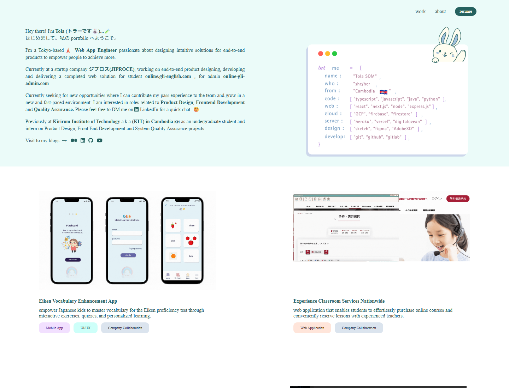

# Tola Som | Portfolio, reimagined

**Made with care. Built for impact.**

**Six years of building, learning, and growing beyond the screen.**

I began by designing and developing education platforms, turning people's needs into digital experiences. Today, as a Data Center Technician at Microsoft in Tokyo, I work on the infrastructure behind those experiences: AI deployments, reliable systems, and automation.

The transition has changed the scale of my work, not its purpose: understand the problem, make things work better, and help people move forward. I still build creative tools, bringing a designer's empathy and a developer's curiosity into every new challenge.

[Original code](https://github.com/ttolaaa/stlaaa-zone/tree/legacy) · [LinkedIn](https://www.linkedin.com/in/som-tola/) · [GitHub](https://github.com/ttolaaa) · [Writing](https://medium.com/@somtola)

## Before

Where I started: product design, web development, and learning experiences. [Original code](https://github.com/ttolaaa/stlaaa-zone/tree/legacy).

## After

Where I'm growing: infrastructure, automation, and creative tools. A new portfolio for the next chapter. [Visit the live site](https://tolaaa-zone.web.app).

**Setup or publish:** follow the [deployment guide](DEPLOYMENT.md).
