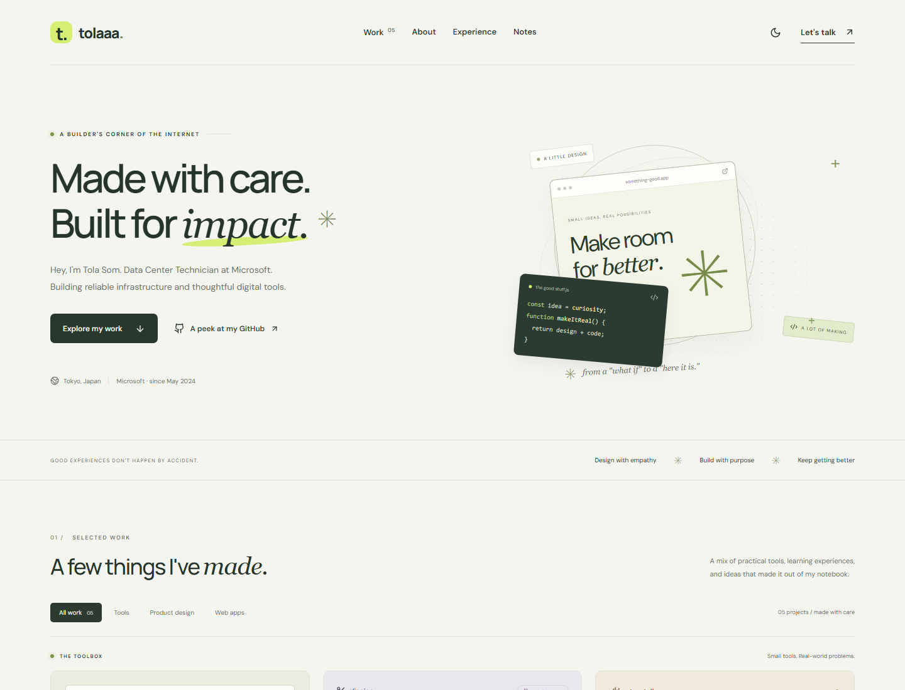
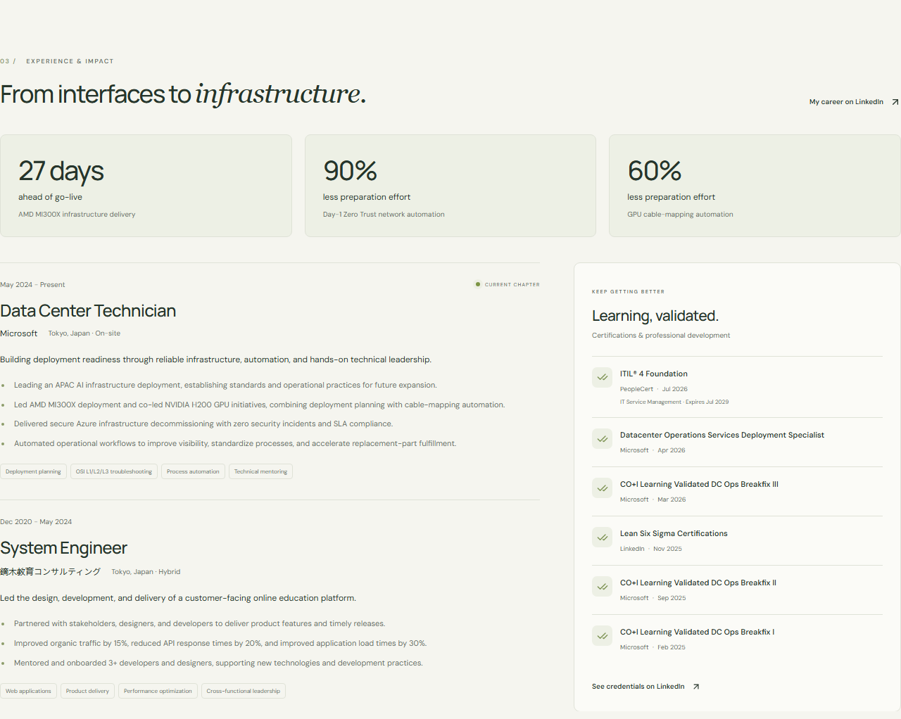
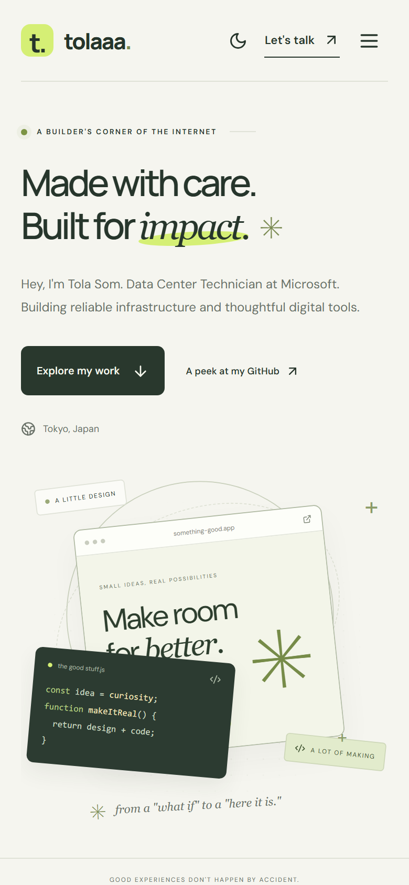

# Tola Som | Portfolio, reimagined

**Made with care. Built for impact.**

From a portfolio about web applications and product design to a fuller picture of who I am today: a Microsoft Data Center Technician in Tokyo who also builds thoughtful digital tools.

[Original portfolio](https://github.com/ttolaaa/stlaaa-zone) · [LinkedIn](https://www.linkedin.com/in/som-tola/) · [GitHub](https://github.com/ttolaaa) · [Writing](https://medium.com/@somtola)

## Before → After

The original website introduced my journey through education, UI/UX, and web development. The redesign keeps those roots while making room for infrastructure engineering, automation, and the creative tools I've built since.

| | Before: the original portfolio | After: the redesigned experience |
| --- | --- | --- |
| **Introduction** | Focused on my web app engineering and product design background. | Connects my current Microsoft role with my experience building digital products. |
| **Visual direction** | An introduction-led layout with project images, descriptions, and a separate About page. | A warm editorial design with sage tones, expressive typography, custom illustration, and light/dark themes. |
| **Browsing work** | Projects grouped into work and personal-project sections. | A curated collection with filters for tools, product design, and web apps. |
| **Project stories** | Image-and-text summaries, with a dedicated Eiken case study. | Project dialogs with screenshots, features, context, limitations, and source links. |
| **Recent projects** | Education platforms, Firebase work, and GlowTracker. | Those earlier stories, plus VDODL, Clipping, and Storyteller with interactive snippets. |
| **Career** | Earlier education and system-development experience. | A career timeline, current infrastructure work, selected outcomes, and six certifications. |
| **Reading & contact** | Blog and social links within the introduction and biography. | Dedicated writing cards, a clear contact section, and social links. |
| **Across screens** | The original browser-based portfolio. | Responsive layouts checked from 320px phones to 2560px monitors. |
| **Returning visits** | The original browsing experience. | An installable PWA with cached offline browsing and automatic version updates when online. |

The original project's source is the reference for the “before” descriptions. The screenshots below show the actual redesigned website, not mockups of an unbuilt concept.

## After: a new first impression

Less biography up front. A clearer introduction, a little personality, and a direct invitation to explore the work.

The new visual language combines a soft neutral background, restrained green accents, and an illustrated design-and-code workspace. Light and dark themes let visitors choose the version that feels right for them.

## The toolbox: three new stories

Useful tools deserve more than a repository link. Each project now has a designed preview, a short explanation of the problem it addresses, and a closer look at the real application.

| Project | What it does | What visitors can try in the portfolio |
| --- | --- | --- |
| [**VDODL**](https://github.com/ttolaaa/VDODL) | Saves permitted video and audio from supported links, with available quality selection and server assistance where needed. | Switch between sample quality options in a miniature download interface. |
| [**Clipping**](https://github.com/ttolaaa/ClippingEditor) | Turns long videos into captioned vertical clips using a local-first editing workflow. | Change sample clip durations and see the preview cards respond. |
| [**Storyteller**](https://github.com/ttolaaa/text2voice_app) | Gives scripts a voice with expressive text-to-speech controls. | Play and stop a short sample through the browser's speech engine. |

**These are clearly labeled portfolio snippets.** Video downloading and editing happen in the full projects, not inside the portfolio. The voice sample uses browser speech synthesis rather than the full Storyteller engine.

## A career story that reflects today

The redesign adds my current **Data Center Technician role at Microsoft, May 2024–present**, alongside my previous **System Engineer role, December 2020–May 2024**.

The experience section brings together infrastructure deployment, operational automation, troubleshooting, product delivery, and mentoring.

Selected outcomes from my supplied career history:

- **27 days ahead of go-live** for an AMD MI300X infrastructure delivery.
- **90% less preparation effort** through Day-1 Zero Trust network automation.
- **60% less preparation effort** through GPU cable-mapping automation.

Certifications include ITIL 4 Foundation, Microsoft datacenter deployment and Breakfix learning validations, and Lean Six Sigma professional development.

These are owner-reported career outcomes, not performance measurements of this website. Credential IDs and granular internal infrastructure details are not displayed.

## Same personality, smaller screen

The experience adapts to a phone rather than squeezing the desktop layout into one. Navigation becomes a compact menu, project cards stack, and career content flows into a single readable column.

  

The portfolio also includes keyboard navigation, focus-aware project dialogs, reduced-motion support, and locally hosted fonts and images. After a successful first online visit and cache setup, the portfolio and project screenshots remain available offline; external links still need a connection.

## What stayed

This is an evolution, not a reset.

- **Eiken Vocabulary App:** the research, design, and Flutter story behind helping young learners practice English.
- **GLI Online Classroom:** the student course-purchasing and lesson-reservation experience.
- **Earlier work:** GlowTracker, lesson reservation administration, and Firebase data management.
- **My roots:** Computer Science at Kirirom Institute of Technology, teaching, writing, and curiosity about how things work.
- **My voice:** approachable, practical, and always learning.

The earlier `/about` and `/eiken-app-case-study` entry points still lead to relevant content.

## The result

A portfolio that connects **interfaces, infrastructure, and useful everyday tools** in one place. Visitors can understand what I do now, explore what I've made, and see the thread running through both: thoughtful work with a practical impact.

The production build and 18 desktop/mobile browser tests passed during implementation, including responsive layout checks, project interactions, offline browsing, and automatic browser updates.

**Publishing status:** Docker packaging and push-to-deploy automation are prepared. Live automatic deployment still requires a GitHub repository, a Docker server, and deployment credentials.

---

Looking for technical setup instead? See the separate [development & deployment guide](DEPLOYMENT.md).
